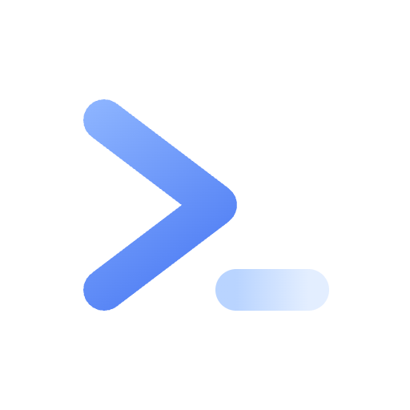

# Welcome to KCS - Koharu Coding Server

> **A passionate community and development ecosystem crafted by Koharu.** 🚀  
> We build innovative tools, Discord bots, and cutting-edge software solutions.

---

## 🌟 Featured Projects

### 1. Sora Bot (`소라 Bot`)

  

* **Description:** An intelligent and interactive Discord bot developed under KCS to enhance server engagement and utility features.
* **Status:** Active & continuously expanding features.

---

### 2. Aura AI (`아우라 AI`)

  

* **Description:** An autonomous language model featuring a unique cat-girl persona, built with a custom tokenizer and trained on large-scale datasets.
* **Status:** Under active training and development.

---

## 🔗 Connect & Links
* **Official Website:** [KCS Website](https://kcs.koharu.live)
  ------------------------------------------------------------
* **Sora Bot Platform:** [Sora Bot](https://sora.koharu.live)
* **Aura AI Platform:** [Aura AI](https://aura.koharu.live)
* **Contact:** admin@koharu.live

